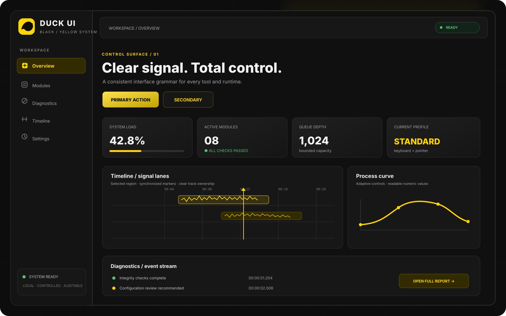

<p align="center"></p>
<h1 align="center">NUN</h1>
<p align="center"><strong>Minimal Kernel Substrate</strong></p>
<p align="center"><strong>Ранний x86_64 kernel bring-up · не полноценная ОС</strong></p>
<p align="center"><a href="README.md">🇺🇦 Українська</a> · <a href="README.en.md">🇬🇧 English</a> · <a href="README.ru.md">🇷🇺 Русский</a></p>
<sub>Обновлено: 2026-11-11</sub>


## Навигация

- [Текущие возможности](#текущие-возможности)
- [Быстрый старт и проверка](#быстрый-старт-и-проверка)
- [Дополнительный Limine boot target](#дополнительный-limine-boot-target)
- [Архитектура и подтверждённые границы](#архитектура-и-подтверждённые-границы)
- [Интерфейс и визуальные материалы](#интерфейс-и-визуальные-материалы)
- [Инженерное качество](#инженерное-качество)
- [Карта документации](#карта-документации)
- [NUN Mesh и связанные репозитории](#nun-mesh-и-связанные-репозитории)
- [Дизайн и документация](#дизайн-и-документация)
- [Лицензия](#лицензия)
- [Палитра Duck Black / Yellow](#палитра-duck-black-yellow)

> **NUN** — NUN — спецификационная основа будущего минимального системного ядра, определяющая архитектурные, boot, memory и execution contracts.

## Текущие возможности
- Версионированный boot handoff contract с NUNLauncher.
- Architecture layer: CPU entry, privilege transitions, exceptions и interrupt vectors.
- Требования к memory model, раннему allocator, виртуальной адресации и защите.
- Readiness gates для воспроизводимой сборки, эмулятора и целевой платформы.

## Быстрый старт и проверка
Соберите существующий Multiboot2 bring-up командой `bash scripts/build-qemu.sh` и запустите `bash scripts/run-qemu.sh`. Отдельный Limine-образ собирается через `make iso`; host-тесты манифеста запускаются через `make test`, QEMU — через `make run`.

## Архитектура и подтверждённые границы
NUN имеет ранний x86_64 Multiboot2 bring-up с serial-консолью, ограниченным physical-page bitmap allocator, IDT exception stubs и PIT IRQ0. Отдельный Limine target собирает BIOS/x86_64 UEFI-образ и проверяет вход в начальную точку ядра в QEMU. Это ранние boot-прототипы, а не полноценная production ОС; scheduler, SMP, ACPI, драйверы, VFS, сеть, userspace и GUI не реализованы.

## Дополнительный Limine boot target

Отдельный `make iso` собирает гибридный BIOS/x86_64 UEFI-образ с закреплённым Limine 12.9.6 и проверкой SHA-256 архива. `make test` запускает host-тесты манифеста, `make run` — образ в QEMU. Этот Limine target пока отдельный от существующего Multiboot2 bring-up и не использует его allocator или стек прерываний.

`make usb DEVICE=/dev/sdX` записывает образ на целый USB-диск. Операция уничтожает все данные на выбранном диске, требует root и точного подтверждения `ERASE /dev/...`. Инсталлятор отклоняет разделы, read-only или смонтированные устройства и системный root-диск. Перед запуском проверьте модель и размер устройства и сделайте резервную копию.

Limine-профиль — ранний x86_64 boot-прототип, а не полноценная ОС или квалификация физического оборудования. Компонент E2K — отдельный Linux userspace runtime под MCST LCC, а не bare-metal E2K kernel; требуется native E2K runner.

## Интерфейс и визуальные материалы

NUN сейчас является спецификационной основой ядра, а не графическим приложением. Скриншотов GUI нет; изображение ниже показывает только общий стиль документации Duck Black / Yellow.

<p align="center"></p>


### Версионированный boot-info контракт

Дополнительно реализован host-tested C11 контракт передачи boot-метаданных: `include/nun/boot_info.h` и `src/boot_info.c` проверяют версию структуры, идентификатор архитектуры, границы образа ядра, entry point и карту памяти. Это проверка входных метаданных; она не заменяет загрузчик, передачу управления ядру, тестирование в эмуляторе или квалификацию на целевом оборудовании.

```sh
cmake -S . -B build -DNUN_BUILD_TESTS=ON
cmake --build build --parallel
ctest --test-dir build --output-on-failure
```

## Инженерное качество
- Запускайте проверки для целевой платформы; host CI не заменяет аппаратную квалификацию.
- Статусы implemented, partial и planned должны подтверждаться кодом, тестами и доказательствами.
- Макет, спецификация или открытый Pull Request не доказывают production-ready реализацию.
- Внешние интеграции должны быть явными, версионированными, изолированными и тестируемыми.

## Карта документации

- [QEMU Multiboot2 kernel bring-up](docs/QEMU_KERNEL_BRINGUP.md)
- [Limine boot и USB-образ](docs/BOOT.md)
- [Схема boot image manifest](spec/boot-image-manifest.schema.json)
- [Профиль E2K Linux userspace](docs/ELBRUS_E2K.md)
- [Композиция возможностей](docs/architecture/capability-composition.md)
- [Интеграция экосистемы](docs/ECOSYSTEM_INTEGRATION.md)
- [Технический долг и границы](docs/TECHNICAL_DEBT_REGISTER.md)

## NUN Mesh и связанные репозитории
[SAMBU](https://github.com/bboroski/SAMBU) · [ToolNG](https://github.com/bboroski/ToolNG) · [ReaperCripple](https://github.com/bboroski/ReaperCripple) · [Kloz](https://github.com/bboroski/Kloz) · [CO](https://github.com/bboroski/CO) · [SaintSI](https://github.com/bboroski/SaintSI) · [Klipot](https://github.com/bboroski/Klipot) · [NUN](https://github.com/bboroski/NUN) · [NUNLauncher](https://github.com/bboroski/NUNLauncher)

Каждый репозиторий сохраняет каноническое имя, собственный код, API, цикл выпуска и границы ответственности. Интеграция означает версионированные контракты, а не автоматическое слияние независимых runtime.

## Дизайн и документация
Общее направление интерфейсов экосистемы — Duck Black / Yellow: тёмные поверхности, жёлтые акценты, читаемая типографика, доступный контраст, клавиатурная навигация и поддержка reduced motion. Это визуальная рекомендация для документации и будущих инструментов, а не утверждение о наличии GUI в NUN.

## Лицензия
Лицензия не объявлена; файл LICENSE отсутствует.

---
**Создано с любовью к инженерии, системности и людям.**

## Палитра Duck Black / Yellow
Совместимые цвета прежних badges и marks: `#FFD600` (жёлтый) и `#111111` (почти чёрный). Текущий фон интерфейса — `#0D0D0D`. Полная палитра из шести цветов, четырнадцати функциональных оттенков и значения RGB/HSL находятся в `design/duck-ui.tokens.json` (schema 3.0.0). Жёлтый зарезервирован для основных действий, фокуса и выделения; красный и голубой обозначают семантические ошибки и информационные состояния.
